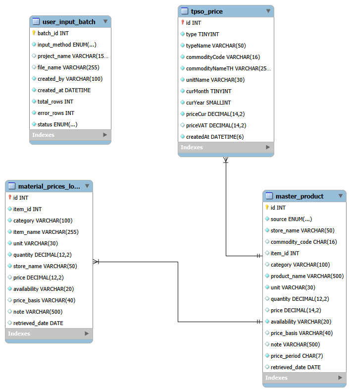
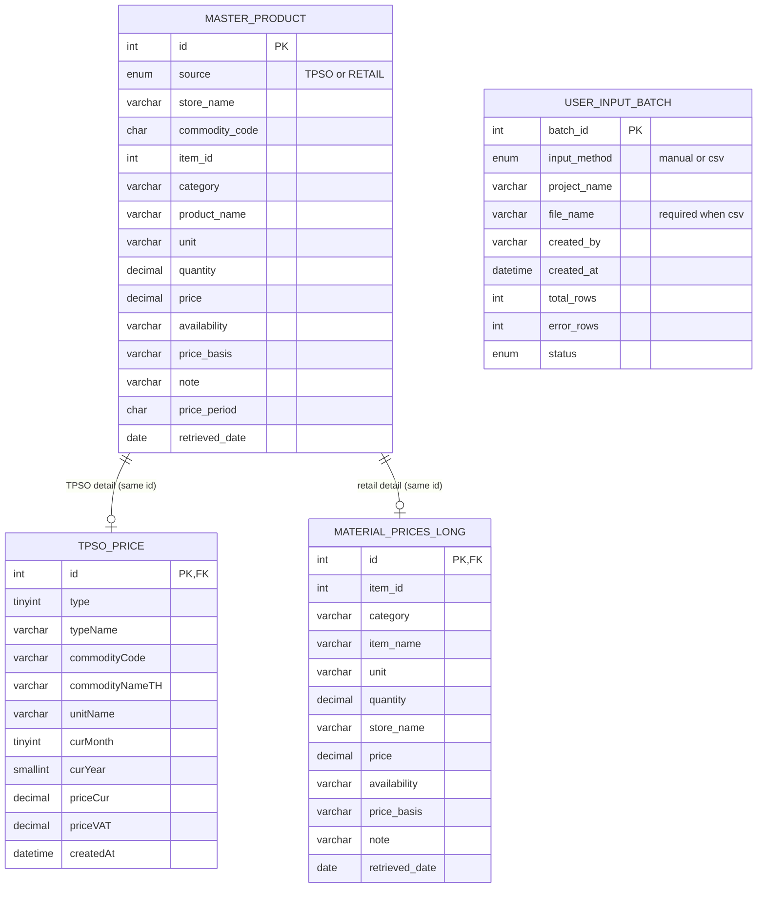

# ER Diagram - BOQ Intelligence Platform

Source of truth: `schema.sql`. Workbench model: `docs/boq_model.mwb`. Exported picture: `docs/er_diagram.png`.

`tpso_price` and `material_prices_long` use the same `id` as their `master_product` row (the foreign key is on the primary key), so each detail row belongs to exactly one master row. `user_input_batch` is not linked to the other tables yet.
