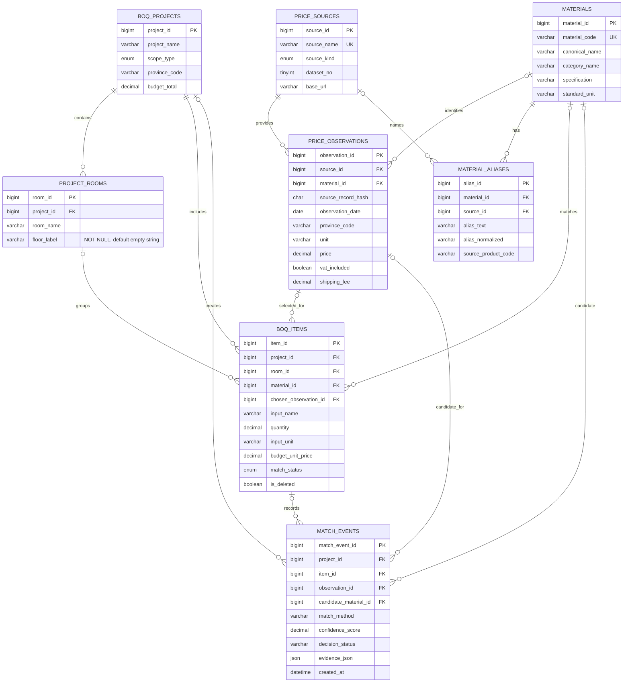

# ER Diagram - BOQ Intelligence Platform MVP

The diagram separates canonical materials, price snapshots, sources, projects and matching evidence. A price comparison is eligible only when the canonical material, unit, specification, area and time window are compatible.

`match_events` is the queryable evidence table. Every event is also appended to `logs/match_audit.jsonl`; events must not be overwritten.
