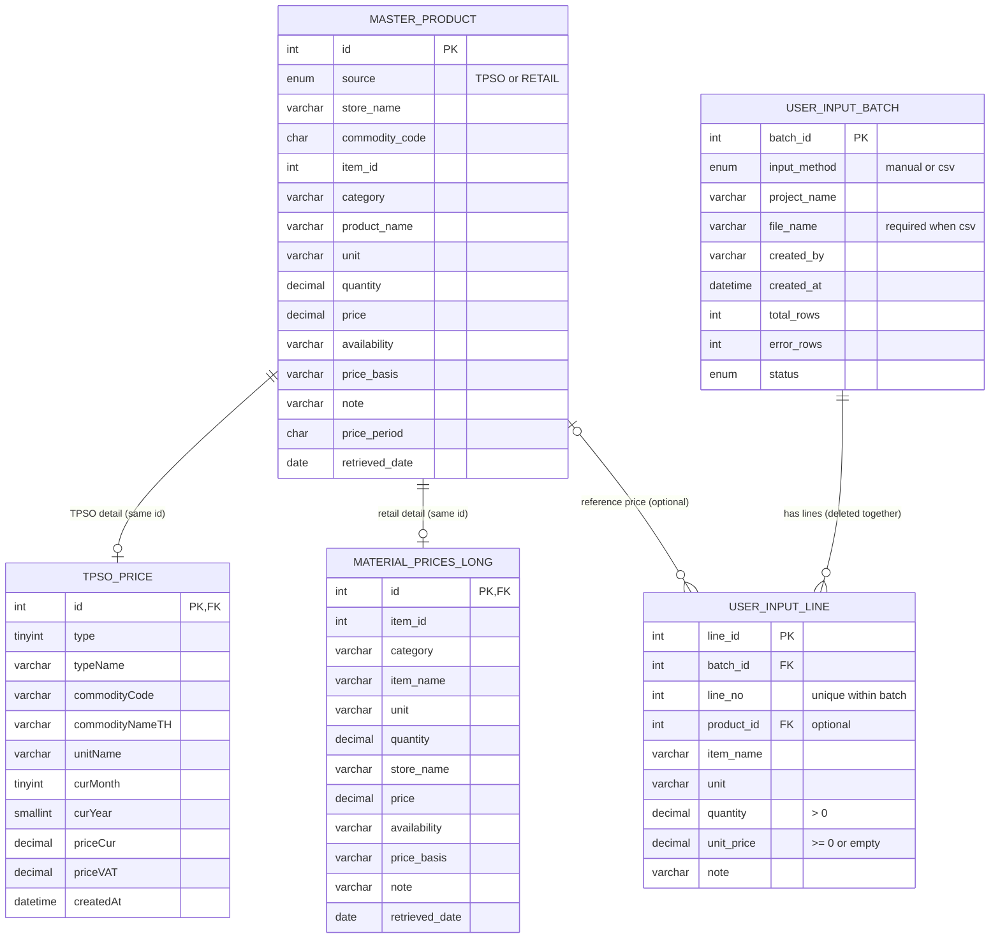

# ER Diagram - BOQ Intelligence Platform

Source of truth: `schema.sql`. Workbench model: `docs/boq_model.mwb`. Exported picture: `docs/er_diagram.png`.

`tpso_price` and `material_prices_long` use the same `id` as their `master_product` row (the foreign key is on the primary key), so each detail row belongs to exactly one master row. `user_input_line` holds the BOQ lines users enter in the GUI (`app_gui.py`), by hand or from CSV; users may create, edit and delete batches and lines, while the price tables stay read-only for them. `product_id` optionally links a line to a price for comparison.

> `er_diagram.png` and `boq_model.mwb` do not show `user_input_line` yet: add it in Workbench and re-export.
